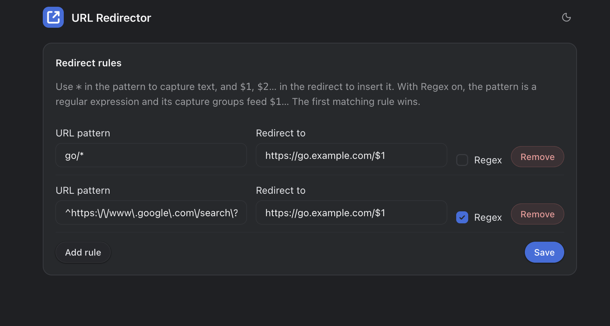

# URL Redirector

Chrome extension to redirect URLs based on patterns.

This extension is simple, OSS, no data collected.

**Personal project**: This is completely vibe coded for my own personal use. I won't be accepting feature requests or PRs. You're welcome to fork it and make it your own.



## Usage

Add rules in the options page. Each rule has a wildcard pattern and a redirect
template:

| Pattern | Redirect                    | Effect                                    |
| ------- | --------------------------- | ----------------------------------------- |
| `go/*`  | `https://go.example.com/$1` | `go/docs` → `https://go.example.com/docs` |

- `*` captures text; `$1`, `$2`… insert the captures in the redirect.
- `http://` / `https://` are optional in the pattern.
- Turn on **Regex** to use a regular expression as the pattern (add your own anchors); its capture groups feed `$1`…
  Chrome runs the redirects itself, so regexes use RE2 syntax (no lookahead or backreferences); `$1`–`$9` are supported.
- The first matching rule wins.

## Development

Built with [WXT](https://wxt.dev), Svelte 5 and ui-sdk. `src/design-system/` is synced from the shared design system and never edited by hand.

```sh
pnpm install
pnpm dev     # run in a dev browser
pnpm build   # output in .output/chrome-mv3
pnpm zip     # package for the Chrome Web Store
pnpm test
```
